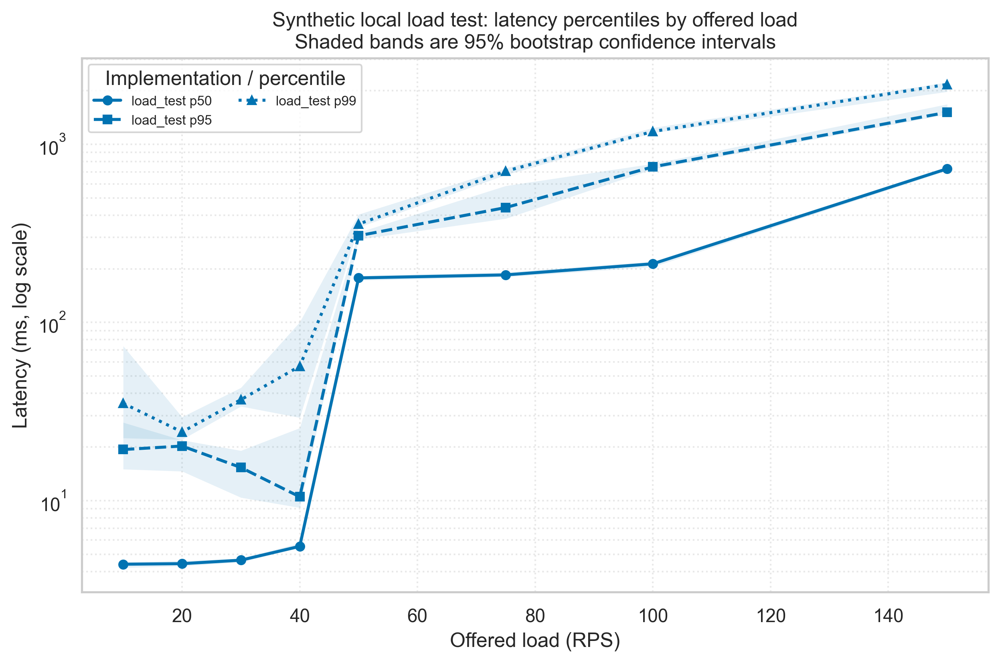
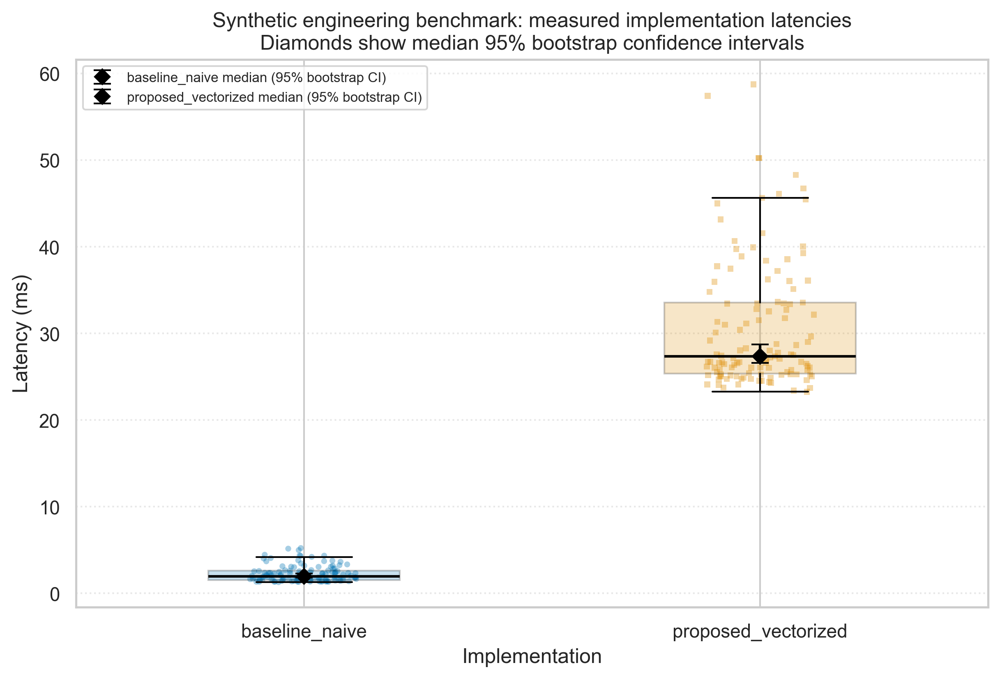

# Psychological Markers of Isolation and Emotional Attachment among Students in Long-Term Interaction with AI Companions

[](LICENSE)
[](LICENSE-DATA)
[](https://www.python.org/)
[](Dockerfile)
[](docs/preregistration.md)

**Authors:** Anna Merkulova, Adilet Bolat  
**Affiliation:** Narxoz University, course SCOM3001  
**Contact:** anna.merkulova@narxoz.kz, adilet.bolat@narxoz.kz  
**Repository:** [https://github.com/adiletbolat-stack/Enviroment](https://github.com/adiletbolat-stack/Enviroment)

This repository provides an end-to-end reproducible research environment, statistical pipeline, and codebook for a mixed-methods content analysis investigating user accounts of long-term AI companion interaction (Replika, Character.ai).

---

## 1. Project Overview and Research Aim

Students increasingly interact with AI companions for emotional support. This study investigates whether the **duration of use** and **intensity of interaction** correlate with **markers of emotional dependence** and **social isolation/avoidance** in written accounts.

### Research Design
- **Type:** Mixed-methods observational design (qualitative content analysis via a frozen codebook + non-parametric statistical hypothesis testing).
- **Unit of analysis:** Unique author (markers and word counts pooled per author, frequencies normalized per 1,000 words). *[ASSUMPTION, confirm: 1 row = 1 author due to lack of author_id in synthetic data]*.
- **Random seed:** Fixed to `42` across all scripts, bootstrap resamples, and random operations.

### Research Questions and Hypotheses

| ID | Research Question | Hypotheses | Statistical Tests |
|---|---|---|---|
| **RQ2** | Does the frequency of emotional dependence markers ($F_i$) differ between novice (< 1 month) and experienced (> 3 months) users? | **H₀:** $F_{<1\text{m}} = F_{>3\text{m}}$<br>**H₁:** $F_{>3\text{m}} > F_{<1\text{m}}$<br>*Secondary:* Monotonic trend across < 1m, 1–3m, > 3m. | Mann–Whitney $U$ (one-sided), Cliff's $\delta$ with 95% bootstrap CI, Kruskal–Wallis $H$, Jonckheere–Terpstra trend test. |
| **RQ3** | Is duration of use associated with the isolation–avoidance index ($I_i$)? | **H₀:** $\rho_s \le 0$<br>**H₁:** $\rho_s > 0$ (positive monotonic relationship). | Spearman rank correlation $\rho_s$, OLS regression controlled for weekly intensity (`sessions_per_week`). |

All hypothesis tests use significance level $\alpha = 0.05$. All study parameters and marker formulas are specified in [`configs/study.yaml`](configs/study.yaml).

---

## 2. Repository Structure

```
.
├── Dockerfile                  # CPU-based reproducible image (Python 3.11.9-slim)
├── .dockerignore               # Minimal build context (excludes caches, local OS files)
├── requirements.txt            # Pinned dependency manifest (single source of truth)
├── environment.yml             # Conda environment manifest (ai-companion-markers)
├── configs/
│   ├── study.yaml              # Methodology parameters, column mapping, marker lists, filters
│   └── config.yaml             # Benchmarking harness parameters and SLO thresholds
├── data/
│   ├── raw/test_run.jsonl      # TRACKED: canonical synthetic benchmark log; other raw files ignored
│   ├── sample/                 # TRACKED IN GIT: minimal sample for Quickstart
│   │   ├── sample.csv          # 10-row dataset sample demonstrating filters
│   │   └── test_run.jsonl      # Byte-identical copy of the canonical log
│   ├── synthetic/              # Local synthetic test dataset (main_dataset.csv, untracked)
│   ├── interim/                # Cleaned analysis-ready dataset (analysis_set.csv)
│   └── processed/              # Benchmark measurements, summaries, and load-test provenance
├── notebooks/
│   └── 01_data_analysis.ipynb  # Executed Task 3 walkthrough and visualization
├── src/
│   ├── load_dataset.py         # Ingestion, schema validation, per-1,000 recomputation, filtering
│   ├── collect.py              # Backward-compatible wrapper for load_dataset
│   ├── stats.py                # Hypothesis tests (RQ2, RQ3, Cliff's delta CI, Jonckheere-Terpstra)
│   ├── metrics.py              # Text metric helpers and author pooling logic
│   ├── benchmark.py            # Microsecond-accurate I/O-isolated benchmarking harness
│   ├── benchmark_comparison.py  # Paired row-wise versus vectorized Task 3 comparison
│   ├── process_data.py         # Warm-up filtering, statistics, bootstrap CIs, and guardrails
│   ├── visualize.py            # Publication-ready load and distribution figures
│   ├── bench_rq2.py            # RQ2 benchmarking target adapter
│   └── env_metadata.py         # Hardware/OS/package environment metadata collector
├── scripts/
│   ├── run_all.sh              # Sample pipeline; prefers the local .venv interpreter
│   └── verify_task3_summary.py # Independent JSONL-to-summary percentile check
├── tests/
│   ├── test_metrics.py         # Unit tests for text tokenization and author-level pooling
│   ├── test_pipeline.py        # Unit tests for per-1,000 formulas, schema checks, and filters
│   └── test_task3.py           # Paired benchmark, guardrail, summary, notebook, and figure checks
├── results/
│   ├── tables/                 # Output tables with synthetic data warnings
│   └── figures/                # Output publication figures with synthetic watermarks
└── docs/                       # Research documentation, preregistration, methodology drafts
```

---

## 3. System Requirements and Prerequisites

| Resource | Specification |
|---|---|
| **Architecture** | CPU only (x86_64 or ARM64 / Apple Silicon). **No GPU or CUDA required.** |
| **RAM** | Minimum 2 GB (4 GB recommended). |
| **Disk Space** | Approximately 1.2 GB for the Python environment. |
| **Operating System**| Linux (Ubuntu/Debian), macOS (12+), or Windows 10/11 (WSL2/PowerShell). |
| **Software** | Python 3.11+ and the pinned packages in `requirements.txt`. |

---

## 4. Quickstart and Reproducibility Guide

The sample pipeline and Task 3 analysis can be run locally without Docker. In Windows PowerShell:

```powershell
# 1. Create a local environment
python -m venv .venv

# 2. Install dependencies through that environment
.\.venv\Scripts\python.exe -m pip install -r requirements.txt

# 3. Run tests and rebuild summaries and figures from the tracked canonical log
.\.venv\Scripts\python.exe -m pytest -q
.\.venv\Scripts\python.exe src\process_data.py --config configs\config.yaml
.\.venv\Scripts\python.exe src\visualize.py
.\.venv\Scripts\python.exe scripts\verify_task3_summary.py
.\.venv\Scripts\python.exe -m jupyter nbconvert --to notebook --execute --inplace notebooks\01_data_analysis.ipynb
```

To collect an additional paired run without replacing the tracked canonical log, pass a unique output path, for example `.\.venv\Scripts\python.exe src\benchmark_comparison.py --config configs\config.yaml --output data\raw\additional_run.jsonl`.

To run the sample wrapper, use Git Bash (or another Bash shell) from the repository root:

```bash
bash scripts/run_all.sh --sample
```

The wrapper prefers `.venv` and writes only to ignored sample-output directories. The canonical benchmark command refuses to overwrite an existing log; remove or archive that specific file before intentionally collecting a replacement.

---

## 5. Data and Synthetic Data Notice

### ⚠️ IMPORTANT: Synthetic Dataset Notice
The dataset provided in `data/synthetic/main_dataset.csv` (and excerpted in `data/sample/sample.csv`) consists of **artificially generated synthetic data**:
- Record identifiers begin with `SYN` (`SYN0001`–`SYN0360`).
- Raw column names contain the suffix `_SIMULATED`.
- **Purpose:** This dataset exists **strictly to verify computational pipelines, data contracts, and statistical testing routines**. It contains no genuine human subject data and **must NOT be used to infer psychological conclusions or real-world prevalence**.
- All resulting tables and plots are automatically watermarked with `# SYNTHETIC DATA -- pipeline test only`.

### Data Specifications and Columns
- **Total simulated records:** 360 rows.
- **Marker definitions:**
  - Emotional dependence frequency $F_i = (\sum m_{ij} / \sum w_{ij}) \times 1000$, where $m_{ij}$ includes `attachment_count`, `fear_of_loss_count`, and `daily_support_count`. *[ASSUMPTION, confirm: dependence composition]*.
  - Isolation–avoidance index $I_i = (\sum a_{ij} / \sum w_{ij}) \times 1000$, where $a_{ij}$ is `social_avoidance_count`. *[ASSUMPTION, confirm: isolation index composition]*.
- **Exclusion Filters:**
  - Minimum post length: `word_count >= 100` (removes 152 low-content rows).
  - Outlier bounds: `word_count <= 3000` (excludes SYN0032 with 4,500 words); `1 <= sessions_per_week <= 21` (excludes non-active users and SYN0008 with 70 sessions/week). *[ASSUMPTION, confirm: outlier thresholds]*.
  - Sample relevance: `student_evidence != "unknown"` (excludes 56 non-student rows). *[ASSUMPTION, confirm: exclude unknown evidence]*.
  - Filtered sample size: 171 clean records for statistical testing.

---

## 6. Benchmarking and Engineering Evaluation

As a separate engineering objective—not part of the behavioral study—the Task 3 harness in [`src/benchmark_comparison.py`](src/benchmark_comparison.py) compares the existing row-wise `metrics.author_level` implementation with a pandas groupby implementation. Both receive the same 1,848-row synthetic input, 80 warm-up calls and 120 paired measured calls per implementation; execution order alternates within pairs. The fixed seed is 42.

- **Canonical source:** [`data/raw/test_run.jsonl`](data/raw/test_run.jsonl) is the tracked JSONL source of the paired comparison. `data/sample/test_run.jsonl` is byte-identical. Other files in `data/raw/` remain ignored.
- **Processing:** [`src/process_data.py`](src/process_data.py) filters by the logged `phase`, retains failed calls for the error-rate guardrail, computes median/p25/p75, mean ± SD, p95/p99 and percentile-bootstrap intervals, and writes the processed CSVs.
- **Load-test source:** the separate tracked open-loop run is [`data/processed/measurements_load.csv`](data/processed/measurements_load.csv), with environment sidecar [`data/processed/measurements_load.meta.json`](data/processed/measurements_load.meta.json). Its derived summary is `data/processed/load_test_summary.csv`.
- **Environment for the paired comparison:** Windows 11 (build 10.0.26200), CPython 3.12.4, Intel Core i5-9300H @ 2.40 GHz (4 physical / 8 logical cores), 17.01 GB RAM. These fields are recorded in the canonical log metadata.
- **Load-test environment:** the separate load-test run used Windows 10, CPython 3.13.0 and Intel Core i5-10300H @ 2.50 GHz; RAM was not captured. Do not combine the two experiments as if they shared one machine.
- **Timing scope:** the paired comparison times only the aggregation functions; input generation, equivalence checks, logging and file I/O are outside the timed interval. Cyclic garbage collection is disabled during both phases.

---

## 7. Limitations

1. **Synthetic Input Data:** Findings generated from `data/synthetic/main_dataset.csv` demonstrate pipeline executability only. Real-world validation requires frozen manual coding on authentic user posts.
2. **Author-Level Identifier Constraint:** The synthetic dataset lacks individual `author_id` identifiers; as a necessary simulation assumption, each row is modeled as one author. In naturalistic corpus collection, multiple posts per author must be pooled to prevent pseudoreplication.
3. **Self-Selection Bias:** Online public posts on Reddit/forums reflect individuals motivated to share experiences publicly, introducing inherent self-selection bias toward extreme emotional attachment or distress.
4. **Non-Causal Design:** Content analysis of cross-sectional accounts demonstrates association, not causality. High interaction frequency may either foster emotional dependence or serve as a coping mechanism for pre-existing isolation.

---

## 8. Citation and License

If you use this codebase or methodology, please cite:

```bibtex
@misc{merkulova_bolat_2026_aicompanions,
  author       = {Merkulova, Anna and Bolat, Adilet},
  title        = {Psychological Markers of Isolation and Emotional Attachment among Students
                  in Long-Term Interaction with AI Companions: A Content Analysis},
  year         = {2026},
  howpublished = {GitHub repository},
  url          = {https://github.com/adiletbolat-stack/Enviroment},
  note         = {Version 1.0}
}
```

- **Source Code** (`src/`, `scripts/`, `tests/`): [MIT License](LICENSE).
- **Data & Documentation** (`configs/`, `data/sample/`, `docs/`): [CC BY 4.0](LICENSE-DATA).

## Results & Discussion

The results below are an **engineering comparison on synthetic input**, not a research result about people. Warm-up calls are excluded by their logged `phase`; the two implementations were measured in one run on the same input and environment. Table values are generated from `data/processed/metrics_summary.csv` and checked by `tests/test_task3.py`.

### Baseline vs Proposed Method

| Implementation | n measured | Errors (rate) | Median (p25–p75), ms | Median 95% CI, ms | Mean ± SD, ms | p95 (95% CI), ms | p99 (95% CI), ms | Speedup (paired 95% CI) |
|---|---:|---:|---:|---:|---:|---:|---:|---:|
| Baseline (naive row-wise) | 120 | 0 (0.0%) | 1.980 (1.537–2.625) | [1.800, 2.292] | 2.275 ± 0.942 | 4.329 [3.724, 4.994] | 5.128 [4.346, 5.228] | reference |
| Proposed (vectorized) | 120 | 0 (0.0%) | 27.360 (25.381–33.576) | [26.602, 28.726] | 30.787 ± 7.519 | 46.142 [40.714, 50.247] | 56.049 [46.620, 58.741] | 0.074× [0.069, 0.079] |

Speedup is defined as baseline mean latency divided by proposed mean latency; values below 1 indicate a slowdown. For this 1,848-row workload, constructing and grouping the pandas frame made the proposed implementation about 13.5× slower. This is a pipeline-engineering observation, not evidence about human subjects or a general claim about pandas.

The percentile-bootstrap intervals use 2,000 resamples and seed 42. The speedup interval resamples paired request IDs. As with all ordered benchmark data, the IID percentile intervals do not model all temporal dependence.

### Load test and visualizations

Figure 1 uses the separate tracked open-loop load-test file, not the paired comparison. It contains 7,125 requests across 10, 20, 30, 40, 50, 75, 100 and 150 RPS; 2 failed requests give a 0.028% error rate, below the configured 1% guardrail. Its data and environment are separately recorded, and its values are not pooled with the paired benchmark.





Both figures have vector PDF and PNG exports in `reports/figures/`. The PNGs are saved at 300 DPI and their pixel-density metadata is rounded up to at least 300 DPI. Figure 1 shows p50/p95/p99 with 95% bootstrap bands; Figure 2 shows the two implementations and the bootstrap 95% CI for each median.

### Domain Model

The research pipeline was analyzed using the STRIDE threat-modeling framework.

The model identifies protected assets, trust boundaries, security threats, potential impacts, and proposed mitigation strategies.

See [Domain Model and STRIDE Analysis](docs/domain_model.md).

### Reproducibility

Restart and run [`notebooks/01_data_analysis.ipynb`](notebooks/01_data_analysis.ipynb) from the repository root, or run the commands in Quickstart. The independent percentile check is `.\.venv\Scripts\python.exe scripts\verify_task3_summary.py`. Bootstrap repetitions and seed are configured in `configs/config.yaml`.

### Research Limitations

The research-question analyses rely on synthetic data and serve to validate the reproducibility of the pipeline. They do not constitute empirical findings about real students or AI-companion users.

The paired comparison was captured on one Windows 11 / CPython 3.12.4 / Intel i5-9300H machine with 17.01 GB RAM. The load-test data came from a separate Windows 10 / CPython 3.13.0 / Intel i5-10300H run whose RAM metadata is unavailable. Neither result should be generalized to other hardware or production systems without additional measurements.
