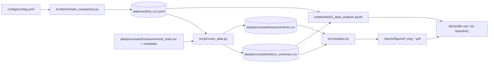

# STRIDE Domain Model — Task 3 Research Pipeline

This design-level review covers repository components used to collect, benchmark,
process, visualize, and publish the synthetic pipeline data. It is not a
penetration test; mitigation status describes repository evidence, not controls
on GitHub or the host computer.

## Data-flow diagram

Trust boundaries are the local machine-to-Git boundary (raw log publication),
the input-file-to-parser boundary, and generated artifacts-to-public-repository
boundary. The tracked benchmark log contains synthetic measurements and
environment metadata; it must not contain credentials or human post text.

## STRIDE matrix

| Component or data flow | STRIDE category | Threat | Protected asset | Mitigation | Status |
|---|---|---|---|---|---|
| `.env` and `src/collect.py` -> Reddit API | Spoofing | A copied or leaked API credential is used as the researcher. | Reddit API account and collection authorization | `.env` and credential files are ignored by Git; use a least-privilege token and rotate it if exposed. | Implemented: ignore rules; credential scope and rotation are operational actions. |
| `data/raw/test_run.jsonl` -> `src/process_data.py` | Tampering | A hand-edited, duplicated, or malformed record changes reported latency summaries. | Integrity of benchmark measurements and derived statistics | Parse JSONL record-by-record; report malformed/schema records; retain source lines and publish the canonical log with summary provenance. | Implemented: parser reports invalid lines/schema; duplicate records are flagged. Cryptographic signing is planned. |
| `src/benchmark_comparison.py` -> JSONL metadata | Repudiation | A result cannot be tied to the measured code, seed, or machine. | Reproducibility and attribution of performance measurements | Record run ID, seed, commit/dirty state, OS, CPU, RAM, Python version, and comparison parameters in the meta record. | Implemented in the benchmark metadata collector and comparison log. |
| `data/raw/*` -> Git repository | Information disclosure | Private raw posts or local user paths are accidentally published with the small benchmark sample. | Post authors' privacy and researcher machine details | Ignore raw data by default; allowlist only `data/raw/test_run.jsonl`; store no post text in the benchmark log and record only the interpreter executable name. | Implemented in `.gitignore`, `src/benchmark_comparison.py`, and `src/env_metadata.py`; review staged files before publication remains required. |
| `data/processed/measurements_load.csv` -> `src/process_data.py` | Denial of service | An unexpectedly large or malformed CSV consumes excessive memory or produces incomplete aggregates. | Availability and correctness of the analysis pipeline | Validate required columns and numeric fields; use tracked, bounded benchmark inputs; add file-size/row limits if untrusted external logs are accepted. | Implemented: schema and numeric validation; hard resource limits are planned. |
| `src/process_data.py` -> `data/processed/*.csv` | Tampering | Stale or partially written outputs are mistaken for the current run. | Summary metrics, confidence intervals, and error-rate guardrail | Regenerate summaries from the canonical JSONL and tracked load-test CSV; retain input run IDs, bootstrap seed/repetitions, and error counts. | Implemented in `src/process_data.py`; output checksums and atomic replacement are planned. |
| `src/visualize.py` -> `reports/figures/` | Tampering | Figures are generated from stale or mismatched summary data. | Published latency plots and their uncertainty intervals | Load the generated summary and measurement tables; label units, source experiment, error guardrail, and bootstrap confidence intervals. | Implemented in `src/visualize.py`; release-time artifact review remains required. |
| `notebooks/01_data_analysis.ipynb` -> Git repository | Information disclosure | Saved notebook output exposes absolute local paths or stale analysis. | Local environment details and reproducibility of reported results | Use repository-relative paths; execute from a clean kernel; validate cell order and saved outputs; exclude checkpoints. | Implemented in notebook checks and `.gitignore`; re-execution is required after data/code changes. |
| Git repository and GitHub branch | Elevation of privilege | An account with excessive repository permissions modifies the published code or results. | Repository integrity and public release history | Apply least privilege, multi-factor authentication, protected branches, and reviewed changes. | Planned: repository settings are outside this checkout and were not verified. |
| `src/benchmark_comparison.py` -> measured functions | Denial of service | A regression or repeated exceptions makes the benchmark run indefinitely or invalidates its comparison. | Availability and validity of the benchmark run | Bound warm-up and measurement counts in config; capture failures and report error rate separately; use the 1% error guardrail. | Implemented in the configured run; operational limits depend on the checked-in config. |

## Scope and limitations

- The benchmark and load-test inputs are synthetic or engineering measurements,
  not observations about people or evidence for the research hypotheses.
- The open-loop load-test CSV was recorded on a separate machine/runtime from
  the paired baseline/proposed comparison; the two runs are not pooled together.
- This model describes repository controls only. GitHub access controls,
  credential scope, host hardening, and external review were not tested here.
