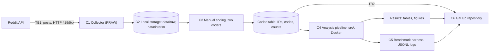

# Domain Model: STRIDE Threat Model of the Research Data Pipeline

**Direction:** Information Security. **Scope:** the pipeline that collects public Reddit posts about AI companions, codes them manually, analyses the coded table and publishes code, tables and figures on GitHub, including the benchmark harness (`src/benchmark.py`) that measures the analysis step.

This is a design-level threat model made by the authors. Scores are team judgement, not measurements, and no penetration test was performed.

## 1. Assets, components and trust boundaries

| ID | Asset | Why it matters |
|---|---|---|
| A1 | Reddit API credentials (`.env`, `praw.ini`) | Access to the platform in the researchers' name |
| A2 | Raw post texts (`data/raw`, `data/interim`, local only) | Personal, emotional content of identifiable people |
| A3 | Coded table (IDs, manual codes, word counts, author IDs) | Basis of every reported result |
| A4 | Codebook v1.0 and `codebook/CHANGELOG.md` | Defines the measured variables; must be frozen |
| A5 | Benchmark logs (`*.jsonl`) and processed tables/figures | Evidence for the reported latency numbers |
| A6 | GitHub repository and releases | Public record of the study |

**Trust boundaries:** TB1 internet and Reddit vs. the authors' machines; TB2 authors' machines vs. public GitHub; TB3 Docker container vs. host.

## 2. STRIDE matrix

Score = Likelihood (1-5) x Impact (1-5). Rating: 15-25 High, 8-14 Medium, 1-7 Low.

| ID | STRIDE | Component | Threat | L | I | Score | Mitigation | Status |
|---|---|---|---|---|---|---|---|---|
| T1 | **S**poofing | C1 / A1 | A leaked API token is used by a third party in the researchers' name | 3 | 3 | 9 (M) | `.env`, `praw.ini` ignored by Git and Docker; revoke and re-issue if leaked; minimal API scope | `.gitignore` rules in repo; token scope to verify |
| T2 | **S**poofing | C2 / A3 | Bots or fake accounts pretending to be students contaminate the sample | 4 | 3 | 12 (M) | Inclusion rule (explicit statement of duration), bot filtering, author-level aggregation, stated as a limitation | Rules in `docs/preregistration.md`; bot filter planned |
| T3 | **T**ampering | C2 / A2 | Raw or interim data altered after coding, so results cannot be reproduced | 2 | 4 | 8 (M) | Store a SHA-256 checksum of each export in the log; re-collect from `post_ids.csv` | Planned |
| T4 | **T**ampering | C3 / A4 | Codebook changed after the freeze to fit the results | 3 | 4 | 12 (M) | Frozen v1.0, `CHANGELOG.md`, pre-registration, review of every change by the second author | Files in repo; review rule to agree |
| T5 | **T**ampering | C5 / A5 | Benchmark logs edited by hand to improve the numbers | 2 | 4 | 8 (M) | Log file created in exclusive mode (never overwritten), `run_id`, Git commit and `dirty` flag recorded in the metadata line | Implemented in `benchmark.py` |
| T6 | **R**epudiation | C3 / A3 | Nobody can show who coded which post and when, so a dispute over Cohen's kappa cannot be settled | 3 | 3 | 9 (M) | `coder_id` and codebook version in the coded table; Git history | Planned |
| T7 | **R**epudiation | C6 / A6 | Results changed without a trace through direct pushes to `main` | 3 | 3 | 9 (M) | Protected `main`, pull requests with review, meaningful commit messages | To enable on GitHub |
| T8 | **I**nformation disclosure | C2, C6 / A2 | Re-identification of Reddit authors through usernames, verbatim quotes or raw texts pushed to GitHub (harm to people writing about emotional topics) | 3 | 5 | 15 (H) | `data/raw` and `data/interim` ignored; anonymous author IDs; no identifying quotes; strip notebook outputs with `nbstripout`; `docs/data_management.md` | Rules in repo; `nbstripout` to install |
| T9 | **I**nformation disclosure | C6 / A1 | A secret committed once stays in Git history even after the file is deleted | 3 | 4 | 12 (M) | Scan history before publishing; rotate any exposed token; enable GitHub secret scanning | To do before release |
| T10 | **I**nformation disclosure | C5 / A5 | Published logs or metadata reveal local details (user name in file paths, host name) | 3 | 2 | 6 (L) | The metadata collector records only the interpreter file name, never the full path; still review any `.meta.json` before publishing | Implemented in `env_metadata.py`; review before release |
| T11 | **D**enial of service | C1 | Reddit rate limits (HTTP 429) or revoked access stop data collection | 4 | 3 | 12 (M) | Keep post IDs, retry with logged back-off, record excluded and deleted posts | Retry policy planned |
| T12 | **D**enial of service | C4 | A huge or malformed post exhausts memory or crashes the pipeline | 2 | 3 | 6 (L) | Edge-case unit tests, explicit exclusion reasons, container resource limits | Tests in `tests/test_metrics.py` |
| T13 | **E**levation of privilege | C6 | A token or collaborator with excessive GitHub rights changes the workflow or history | 2 | 4 | 8 (M) | Least privilege, two-factor authentication, protected `main` | To verify |
| T14 | **E**levation of privilege | C4 / TB3 | Container running as root with the repository mounted | 2 | 3 | 6 (L) | Non-root user in the `Dockerfile`; no `--privileged` | Implemented in `Dockerfile` |
| T15 | **T**ampering | C4 | Supply chain: an unpinned or compromised package changes results or runs malicious code | 2 | 4 | 8 (M) | Exact versions in `requirements.txt`, lock file after the first build, recent releases only | Pins in repo; lock file to create |

## 3. Priorities

1. **T8 (15, High):** protect the people behind the posts. This is the main residual risk of the study.
2. **T2, T4, T9, T11 (12, Medium):** sample integrity, frozen codebook, secrets in history, rate limits.
3. Everything marked "to verify", "planned" or "to do" must be closed or listed in `docs/limitations.md` before submission.

## 4. Limits of this model

- Scores are subjective and were not reviewed by an external party.
- Only the research pipeline is modelled; Reddit's and GitHub's own security is out of scope.
- Status values describe the repository at the time of writing and must be re-checked before the final commit.